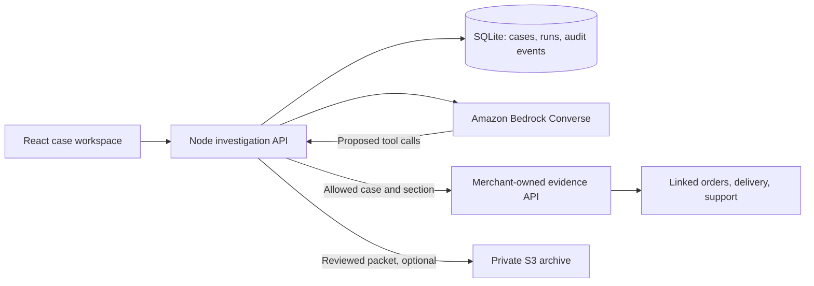

# Casework

A dispute investigation workspace for ticketing businesses, built for the AWS track at SCU. Connect a complaint to its payment, order, tickets, delivery attempts, and support history, then prepare a sourced response for human review.

Includes a working sample workspace, Amazon Bedrock tool calling, a merchant-owned evidence API client, SQLite persistence, reviewed Markdown/JSON exports, and optional private Amazon S3 archiving. All included ATMSPHR cases are **entirely synthetic**, not Eric's customer records, actual Stripe disputes, or measured business results.

## Run locally

Use Node.js 24 LTS and npm.

```sh
npm ci
cp .env.example .env
npm run dev
```

Open **http://127.0.0.1:5173**. The API runs on port 3001. Select a case, investigate, inspect source records, edit the response, mark it reviewed, and export the evidence packet. Stop cancels further investigation requests.

Sample mode requires no credentials. It uses deterministic rules over retrieved sample evidence and is labeled in the interface. It does not call an AI model or AWS. Bedrock mode never silently falls back to the sample investigator.

## Connect AWS

The [organizer setup guide](https://github.com/SCUACM/aws-access-26/tree/main/1-setup) is linked from Discord's resources channel. Each teammate joins the team's Workshop Studio environment with their own SCU email through [Your team](https://judging.scuacm.com). Use **us-east-1** and temporary session credentials. Do not create long-lived IAM access keys.

Load the temporary credentials into your local environment or AWS profile, including `AWS_SESSION_TOKEN`. Keep credentials outside Git and frontend configuration. Select a model or inference profile supporting Converse tool use from the workshop catalog, then configure `.env`:

If you pasted the workshop exports into a terminal, run `node scripts/save-aws-session.mjs` from that same terminal to make them available to this app's other processes. The script writes only the three required session variables into Git-ignored `.env.aws` with owner-only permissions. It never prints their values. The session still expires normally.

```dotenv
INVESTIGATION_MODE=bedrock
AWS_REGION=us-east-1
BEDROCK_MODEL_ID=your-enabled-model-or-inference-profile-id
```

Verify the session, then optionally send one small synthetic tool-call request:

```sh
npm run aws:check
npm run aws:check -- --invoke
```

Restart after changing configuration. Bedrock can investigate the sample cases before customer data is connected. The UI separately identifies investigation mode and evidence source. Refresh expired workshop credentials; model access can fail independently of account authentication.

## Connect ATMSPHR

ATMSPHR hosts a narrowly scoped evidence endpoint. Casework never needs its database credentials. The merchant resolves approved case/payment/order relationships, constrains queries, and allowlists returned fields.

```dotenv
MERCHANT_EVIDENCE_URL=https://your-merchant-api.example
MERCHANT_EVIDENCE_TOKEN=your-server-only-case-access-credential
```

Casework requests `{base}/v1/cases/{caseId}/evidence?section=summary` and other permitted sections. Use **Import case** once connected. The importer validates case identity, verified mapping, and corroborating payment/order references.

See [the exact API contract](docs/EVIDENCE_API.md). The merchant endpoint must be implemented and deployed in ATMSPHR's own backend. This repository has not changed or connected to that backend.

## Architecture



The controller validates tool arguments, bounds requests, checks citations, preserves source limitations, and requires review before export. Customer text cannot grant permission. This prototype is one operator workspace with one configured merchant connection, not a multi-tenant SaaS authorization system.

| Location | Responsibility |
|---|---|
| `src/` | Case list, live activity, source drawer, response review, exports |
| `shared/types.ts` | Shared domain contract; money uses integer minor units |
| `server/` | API, evidence client, Bedrock loop, validation, SQLite |
| `server/fixtures.ts` | Fictional ticket-dispute cases |
| `scripts/aws-check.ts` | Session and Converse verification |
| `infra/evidence-bucket.yaml` | Optional private archive template |
| `tests/` | API, evidence/report, and browser checks |

## Persistence and deployment

`npm run build && npm start` serves the frontend and API together. SQLite defaults to `.data/casework.sqlite`, which is ignored by Git. Interrupted investigations are marked failed after restart and can be retried.

The Dockerfile builds the same app. Preserve `/app/.data` with a persistent volume. This runtime requires a long-lived process; request-scoped serverless functions can freeze background investigations. Horizontal replicas need shared storage and a durable queue, which are future work.

Before exposing the app, set a random `APP_ACCESS_TOKEN` of at least 32 characters and `APP_ORIGIN` to its exact HTTPS origin. Production uses HttpOnly, SameSite cookies and requires HTTPS. AWS and merchant credentials stay server-side.

Set `S3_EVIDENCE_BUCKET` to enable reviewed-packet archival. The runtime identity needs `s3:PutObject` for the packet prefix. The optional CloudFormation template creates a private, encrypted, versioned bucket with a TLS-only policy and retains it on stack deletion. It does not deploy the application or create credentials. Follow the merchant's retention requirements for stored evidence.

## Verify and hand off

```sh
npm run check
npx playwright install chromium
npm run test:e2e
```

Local checks do not establish live AWS connectivity. Use the separate AWS check after configuring a workshop session.

- [Handoff and live integration steps](docs/HANDOFF.md)
- [Demo walkthrough](docs/DEMO.md)
- [Recorded demo, source footage, and Higgsfield edit](docs/demo/README.md)
- [Business assumptions and pilot measurements](docs/BUSINESS.md)
- [Merchant evidence API](docs/EVIDENCE_API.md)

The pilot should measure preparation time and evidence quality on matched cases. Win-rate improvement, pricing, and demand remain hypotheses. Rentul is the next adapter. Automatic refunds, dispute submissions, and outbound customer messages are outside this prototype.
