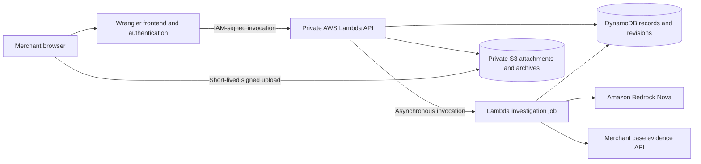

# Causality

For the final AWS-track submission, start with the [submission checklist](docs/submission/README.md) and [judge walkthrough](docs/submission/judge-guide.md). These describe the final feature-branch deployment; historical validation notes below are not the current submission checklist.

Causality investigates payment disputes using the records behind a transaction: tickets, delivery attempts, support messages, payment history, and relevant policies. The operator reviews sourced findings, edits a response, approves its exact revision, and exports or archives the packet.

The hackathon deployment uses an **AWS backend and database**. Cloudflare Workers serves the existing Causality interface and an authenticated bridge. Private AWS Lambda runs the application, DynamoDB stores its records, S3 stores attachments and approved archives, and Amazon Bedrock performs the investigation.

## Architecture



The development stack is `causality-hackathon-dev` in `us-east-1`. Its frontend is [causality-hackathon-dev.slidah60.workers.dev](https://causality-hackathon-dev.slidah60.workers.dev). The API and investigator have separate Lambda concurrency limits, so background model calls do not consume the capacity reserved for polling, cancellation, and review.

**Verification status:** Direct AWS acceptance passed with `npm run test:aws:smoke`: DynamoDB persistence and owner isolation, all three asynchronous ticket investigations, private S3 upload/validation/download, cancellation, concurrent approval preservation, approved S3 archival, and a complete real Nova investigation with validated citations and a newly unapproved draft. That acceptance run used `us.amazon.nova-2-lite-v1:0`. The current default is Claude Opus 5 (`us.anthropic.claude-opus-5`). Published browser acceptance also passed with `npm run test:dev:smoke`: authenticated frontend, signed Lambda bridge, real Bedrock investigation, reviewed approval/export, S3 archive, and browser upload/private download, with no JavaScript errors. ATMSPHR production data and Stripe submission remain unconnected.

**Guided connector verification:** `npm run check` passes 291 tests plus typechecks and frontend/AWS builds. The 17 browser checks include both setup templates, invalid mapping recovery, mobile behavior and existing review workflows. `npm run test:connectors:aws` passed actual DynamoDB setup/import/isolation/revocation and real Bedrock runs for both fictional schemas. `npm run test:connectors:browser` passed the published wizard, manifest downloads and sample imports for both businesses. Live merchant database installation remains unverified; these results use explicitly fictional source records.

There are no D1 or R2 bindings in the development deployment. The temporary development D1 database was deleted. Legacy D1/R2 modules and migrations remain only for the original Sites compatibility path and local regression tests; they do not store the AWS deployment's data.

## Product behavior

- The existing Causality landing page, onboarding, queue, evidence library, connections, activity, settings, and review interface are preserved.
- Six explicitly loaded synthetic cases include three ATMSPHR-style ticket disputes. Sample loading is idempotent and preserves edits to existing samples.
- **Sample investigation** is deterministic, is labeled as such, and runs only on sample cases. **AWS investigation** uses Bedrock Converse tool calls. An AWS failure never becomes a sample result under an AWS label.
- A merchant-owned API returns only selected records linked to an approved case. The model cannot choose another case, database query, or arbitrary endpoint.
- Connections now includes a guided evidence setup: choose a ticketing or rental example, confirm table relationships and shared fields, preview allowed records and rejected case access, then save the configuration in DynamoDB. Both examples are explicitly fictional schemas and data. A saved mapping does not claim a live database connection.
- Downloaded mapping and read-role files configure the same packaged merchant connector. It creates the HTTP endpoint without customer-written service code, verifies Stripe payment scope, and runs bounded read-only PostgreSQL queries. Database permission review, a real case grant, and public HTTPS hosting remain required. See [the guided connector setup](docs/CONNECTOR_SETUP.md).
- A deployed evidence API can be connected, rechecked, imported, and disconnected in Connections without editing Lambda settings. Each connection requests one configured case after checking its live summary and a random unrelated-case rejection. That rejection is a smoke check, not proof of the token's complete access scope; the merchant service must enforce the case grant. Credentials use separate private DynamoDB items, protected by table encryption at rest, and are omitted from public metadata, workspace state, and audit details. Disconnect deletes the saved credential and blocks later reads and publication while retaining imported evidence. Revoke the merchant's grant too to invalidate copies of the token elsewhere.
- Each saved configuration can import its sample once into the existing AWS investigation and review workflow. Revoking that configuration prevents further imports and installation-file downloads while retaining imported evidence. It does not disable a separately deployed merchant service.
- Investigations run asynchronously in Lambda. The browser polls persisted progress, and cancellation prevents later tool/model steps and draft publication.
- DynamoDB conditional transactions protect case data, active runs, draft revisions, approval state, and Stripe submission claims. A stale result cannot replace newer source records or a reviewer's edits.
- PDFs, images, UTF-8 text, CSV, JSON, and email files upload directly to private S3 using a short-lived signed form. Finalization validates the stored bytes before attaching them to a case. File downloads require case ownership.
- Approved packets can be explicitly archived to private S3. The JSON packet contains the response, findings, and evidence metadata; original attachments remain separate private S3 objects.
- The Stripe connector retains account/environment validation, paginated sync, webhook verification, and separately enabled exact-revision submission. Refunds and customer messaging are not implemented.

## Development access

The deployed preview requires username `dev` and its development password. The password is saved locally in Git-ignored `.dev-worker-access.txt` with owner-only file permissions. Share it separately from the repository; never commit it or paste it into a public demo.

On another computer, securely copy that private access file to reuse the same login. `npm run init:dev-access` creates a new random password only when the file is absent. Syncing a newly generated password changes the shared deployment's login.

This is a shared team development workspace. The Worker strips caller-supplied platform identity headers and inserts a fixed reviewer identity only after password verification. The original Sites-managed identity path remains available in its own deployment mode. The development password gate is not production multi-user authentication.

## Setup and deployment

For the local desktop preview, run `npm run dev`. It applies pending local database migrations before starting the server, so a fresh checkout can open `/workspace` without a separate build or manual schema setup. This uses local D1/R2 emulation; it does not connect to or migrate the deployed AWS database. Sign-in uses the local development identity. Case and screen query parameters survive the sign-in redirect.

Use Node 22.13 or newer. Install dependencies and run checks:

```sh
npm ci
npm run install:connectors
npm run check
```

Use the organizer's [AWS workshop access guide](https://github.com/SCUACM/aws-access-26). In a terminal containing the current Workshop Studio credential exports, save the temporary session without printing it:

```sh
node scripts/save-aws-session.mjs
npm run aws:check -- --invoke
npm run sync:dev-secrets
```

The save helper writes the three temporary credential variables to Git-ignored `.dev.vars`, preserving other settings. Saved session credentials take precedence over stale terminal exports; a partial saved session is rejected. Explicit region, model, and origin overrides remain supported. `sync:dev-secrets` sends those credentials and the existing private development password to the Wrangler secret store without committing them. The default region is `us-east-1` and model is `us.anthropic.claude-opus-5`. The model check sends a small synthetic tool-use request.

Deploy the AWS backend, then the Wrangler frontend:

```sh
npm run deploy:aws
npm run deploy:dev
```

`deploy:aws` builds the Lambda archive, updates the CloudFormation stack in `infra/aws-backend.json`, and uploads the backend code. Set `CAUSALITY_FRONTEND_ORIGIN` to the deployed frontend origin when provisioning or changing its S3 CORS configuration. Generated resource outputs are saved in ignored `.aws-build/deployment.json`.

`deploy:dev` publishes the frontend configured by `wrangler.dev.jsonc`. It does not replace the original Sites application. The hackathon deployment explicitly enables `DEV_PUBLIC_WORKSPACE=true`, opening the existing live shared workspace without a login. Set that flag to `false` and redeploy to restore Basic authentication using `DEV_ACCESS_PASSWORD` (at least 32 characters). Keep the password and temporary AWS bridge credentials in the Worker secret store, never in public variables. Use `npm run sync:dev-secrets` after refreshing `.dev.vars`; deployment alone does not copy local secrets.

The bridge's temporary workshop credentials expire. Refresh them before the demo and run `npm run sync:dev-secrets` to update the deployed Worker secrets. Lambda uses its own execution role for DynamoDB, S3, Bedrock, and background invocation; it does not depend on copied workshop credentials internally. An expired bridge session can interrupt the UI while stored data and an already-running Lambda job remain in AWS.

## Runtime configuration

| Location | Values |
| --- | --- |
| Frontend Worker public configuration | `DATA_BACKEND=aws`, `DEPLOYMENT_MODE=standalone-dev`, `DEV_PUBLIC_WORKSPACE=true`, `AWS_REGION`, `AWS_BACKEND_FUNCTION`, `EVIDENCE_BUCKET_ORIGIN` |
| Frontend Worker secrets | `DEV_ACCESS_PASSWORD`, `AWS_ACCESS_KEY_ID`, `AWS_SECRET_ACCESS_KEY`, `AWS_SESSION_TOKEN` |
| Lambda, provisioned by CloudFormation | `CAUSALITY_TABLE`, `EVIDENCE_BUCKET`, `BEDROCK_MODEL_ID`, `FUNCTION_NAME` |
| App Connections, live evidence API | Public HTTPS base URL, approved external case ID, case-scoped API token; stored in the owning AWS workspace |
| Lambda, optional legacy merchant connection | `MERCHANT_EVIDENCE_URL`, `MERCHANT_EVIDENCE_TOKEN`, `MERCHANT_WORKSPACE_ID` |
| Lambda, optional Stripe connection | `STRIPE_RESTRICTED_KEY`, `STRIPE_WORKSPACE_ID`, `STRIPE_WEBHOOK_SECRET`, `STRIPE_ALLOW_LIVE`, `STRIPE_ENABLE_SUBMISSION` |

Use Connections for new merchant evidence connections. The app sends the entered case token to AWS once for verification and storage; list responses never return it. Configure optional legacy merchant and Stripe credentials on Lambda, preserving infrastructure-provided values and binding them to the exact workspace ID shown in the interface. A successful connection check establishes access at that time; recheck or an actual operation verifies continued access.

## Limits and current boundaries

The AWS implementation supports 30 saved live endpoint connections per workspace, each for one approved case, 90 evidence records per case, 300 KB per DynamoDB item, 3 MB per database transaction, 1 MB of normalized investigator context, and 10 MB per uploaded file. Disconnected connection records count toward the saved limit. Reads are paginated and fail explicitly at their configured bounds instead of silently returning incomplete evidence. Run time and tool/model rounds are bounded. [Stripe and Supabase OAuth onboarding](docs/OAUTH_CONNECTORS.md) now supports customer authorization, token refresh/disconnect, Stripe read verification, and Supabase project selection and public-schema review. [Selected dispute import and reviewed linked evidence](docs/LINKED_EVIDENCE.md) use a customer-approved order/payment mapping. Automatic semantic inference and automatic merchant-service hosting are not implemented.

PDF and image contents are not extracted automatically. The operator can inspect the originals; the model is told when relevant content is unavailable. Gmail OAuth and reviewed plain-text email import are implemented. Google registration is complete and deployed in Testing mode; a listed Google account still needs to complete the customer test in [the Gmail handoff](docs/handoffs/06-gmail-oauth-registration.md). A separate [IMAP connector](docs/IMAP_CONNECTOR.md) supports in-app setup for Network Solutions and compatible providers, with case-bound search and reviewed plain-text imports. Real mailbox acceptance is still pending. Independent reviewer membership, automatic retention deletion of imported evidence, refunds, and outbound customer messages are not implemented. Saved policies and access requests do not grant broader permissions.

All bundled records are fictional. A real Bedrock run over them is a synthetic-data demonstration. No improvement in win rate, revenue recovery, or operator time has been established. The first pilot is ticket-dispute preparation with ATMSPHR; Rentul is a later adapter to validate.

Stripe submission is disabled by default. The new customer OAuth app grants only dispute and charge reads and does not enable submission. The separate legacy operator-key submission path requires the correct connected account, a Stripe-imported case, current evidence, an approved exact draft revision, and explicit confirmation. Cases with file attachments are blocked from text-only submission. Ambiguous results stay locked for reconciliation. The password-protected development endpoint is not automatic public Stripe webhook ingress; a separately reviewed ingress path is required. Black Label Creators LLC owns the developer app; customer installation remains an explicit in-app authorization step.

## Verification and compatibility

```sh
npm run check
```

The checks cover type safety, existing backend/Stripe/currency behavior, legacy migrations, development authentication, investigation reasoning, native AWS behavior, and both application and Lambda builds.

The deployed AWS acceptance test is separate:

```sh
npm run test:aws:smoke
```

It targets the named hackathon development backend, creates isolated synthetic workspaces and S3 objects, and makes real Bedrock requests. It has passed the AWS persistence, investigation, file, cancellation, approval-race, and archive scenarios described above. Results are written to ignored `.aws-build/smoke-result.json`. It directly invokes Lambda, so it does not verify the public frontend bridge or browser CORS.

`npm run test:dev:smoke` exercises the published browser flow using the private access file. It runs a real Bedrock investigation on the shared synthetic ATM-1042 case, approves and exports the response, archives it to S3, and uploads/downloads a synthetic attachment. It writes ignored `.aws-build/browser-smoke.json`. Run it when those changes to the shared demo workspace are appropriate.

For the retained local Sites compatibility test path only:

```sh
npm run build
npm run db:migrate:local
npm start -- --port 8788
CAUSALITY_API_TEST_BASEURL=http://127.0.0.1:8788 npm run test:api
CAUSALITY_API_TEST_BASEURL=http://127.0.0.1:8788 npm run test:api:investigation
```

Those local regression tests use D1/R2 emulation and trusted test headers bound to loopback. They do not exercise the deployed AWS database. Keep `sites()` in `vite.config.ts`, managed identity code, and `.openai/hosting.json` intact for that compatibility path.

## Source map

| Path | Responsibility |
| --- | --- |
| `components/workspace/`, `app/` | Causality interface and original Sites routes |
| `worker/index.ts`, `lib/server/dev-auth.ts`, `lib/server/aws-bridge.ts` | Protected frontend and private Lambda bridge |
| `aws/handler.ts`, `aws/workspace.ts`, `aws/store.ts` | AWS API, business actions, DynamoDB conditional persistence |
| `aws/investigations.ts` | Background jobs, trace persistence, scoped evidence, cancellation and final publication |
| `aws/connectors.ts`, `lib/evidence-connectors/` | DynamoDB setup configurations, validated mappings, bounded query plans, fictional access previews and sample imports |
| `aws/managed-connectors.ts`, `aws/merchant-network.ts` | Workspace-owned live connection registry, separate private credentials, public HTTPS verification and guarded merchant requests |
| `components/workspace/connector-setup.tsx` | Guided mapping, case preview and installation downloads in Connections |
| `integrations/evidence-connector/` | Shared merchant-hosted PostgreSQL runtime, guided installer, private grants and live payment verification |
| `aws/files.ts` | Signed S3 uploads, validation, private downloads and approved archives |
| `aws/stripe.ts`, `lib/stripe/model.ts` | AWS-backed Stripe integration and submission state machine |
| `lib/investigation/` | Portable Bedrock/sample engine, merchant wire contract and citation checks |
| `lib/demo.ts`, `lib/ticket-demo.ts` | Six synthetic evaluation cases |
| `infra/aws-backend.json`, `scripts/build-aws.mjs`, `scripts/deploy-aws.mjs` | Reproducible AWS infrastructure and deployment |
| `lib/server/`, `db/`, `drizzle/` | Retained legacy Sites implementation and local regression path |
| `tests/` | Unit, API and browser verification |

See [handoff](docs/HANDOFF.md), [merchant API](docs/EVIDENCE_API.md), [demo](docs/DEMO.md), [business validation](docs/BUSINESS.md), and [branch comparison](docs/BRANCH_COMPARISON.md). The retained `docs/demo/` video shows the older standalone Casework interface. Record a fresh Causality demonstration for submission.

## Desktop screen library

Open `/design/screens` for the complete catalog of **53 desktop screens and meaningful states**. Each individual screen is available at `/design/screens?screen=<id>`; the catalog is defined in `lib/design/screens.ts`. Marketing uses the live landing page. Sign-in, onboarding, workspace, cases, evidence, policies, reports, submission states, connections, governance, settings, and recovery have individual entries.

The design library renders the **same components as the product**, with isolated synthetic fixtures from `lib/design/fixtures.ts`. It does not fetch the workspace API, read a connected account, mutate workspace data, upload files, or invoke Stripe. Every screen is labeled as a synthetic preview; the populated overview exercises manual-case metrics, while submission lifecycle examples remain sample cases. None can be submitted. It is a read-only review surface, separate from authenticated `/workspace`.

The completed desktop flow includes:

- A setup checklist based on actual business details, policies, cases, and evidence readiness.
- Case, report-tab, evidence-record, source-detail, access-request, and settings deep links. Search and status filters are reflected in the URL.
- Clickable finding citations, an original evidence inspector, and policy attachment that copies a versioned policy snapshot through the existing evidence API. Adding evidence invalidates prior approval.
- A structured report preview and TXT export. Unsaved working copies are explicitly unapproved; approval applies only to a saved revision. Leaving an edited report warns before discarding changes, including browser history navigation.
- Explicit submission readiness, verification, submitted, won, and lost views. These reflect stored status and known timestamps; they do not invent receipt IDs, bank decisions, or recovered revenue. Submission still requires separate confirmation and supported server configuration.
- Dedicated Stripe, selected-email, and company-record setup screens. Stripe stays disconnected until explicitly configured. Gmail registration is deployed in Testing mode, with real customer authorization and mailbox reads still to be tested; the separately developed database gateway remains independent.
- A **browser-local, unenforced data-scope draft** and illustrative disclosure preview. The draft contains proposed fields and rules only; saving it does not grant access, execute queries, redact data, or schedule deletion. Automatic retention enforcement remains unimplemented.
- Access request details, separate business/account settings, branded missing-page and unavailable-case recovery, session-expiry recovery, and meaningful loading/error states.

Event timestamps use explicit UTC formatting so server-rendered screens and browser previews agree. Original-file uploads do not extract text from PDF or image files; record event dates are entered separately from upload time.

The editable design workspace is [Causality , Product screens & explorations in Paper](https://app.paper.design/file/01M6W064D6MP5J2SSBARYR50AB/p-5-0). Numbered pages organize the desktop flow; earlier landing explorations remain in the same file.
