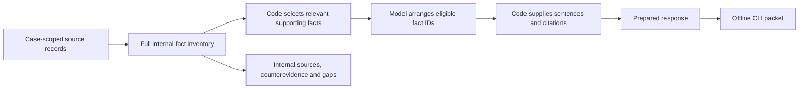

# Verified inventory and command-line evidence packets

The report engine now separates source retrieval, factual wording, evidence strength, packet selection and presentation. The merchant evidence API's grants, database queries and wire contract are unchanged.

“Verified” means that a sentence is produced by an implemented rule from selected source fields, with a code-owned citation. It does **not** mean that Causality independently authenticated the upstream record or proved a real-world event. Source authenticity, field semantics and completeness remain review responsibilities.



## How claims are controlled

1. Code retrieves all eight authorized sections, summary first. The model cannot omit a source section or select another case. Existing ownership, cancellation, source-version and draft-version checks remain.
2. `lib/investigation/facts.ts` derives statements from bounded, recognized fields. Payment capture is not inferred from order status. Ticket status is not delivery. A resend request is not its outcome. Queue state is not a provider delivery event. A support acknowledgement requires an explicit order match, customer role, matching-thread marker and acknowledgement flag. A record containing a different order reference is rejected.
3. Unsupported free-text schemas become attributed excerpts for internal review. They cannot become affirmative outgoing claims. All original evidence stays available; the inventory never replaces source records.
4. Code computes evidence strength independently of the merchant policy. `supported`, `mixed` and `insufficient` do not predict who wins. The first rule set covers `product_not_received`; other reasons need specialist review and get no automatic affirmative packet selection.
5. The model receives only eligible fact IDs, their section and fixed wording. Its only output is a strict `finish_report` layout: `{sections: [{section, factIds}]}`. Prose, citations, labels, extra fields, unknown IDs, duplicates, wrong sections and omitted eligible facts are rejected. There are at most three attempts, with no silent sample fallback after an AWS failure.
6. Code renders the original fact sentences and their source IDs. Dates use the recorded event time zone in code. Missing source sections produce a single internal gap each, with source-specific qualifications retained separately.

## Challenge every case, without inventing a case

The merchant-selected preparation policy is `challenge_all`. This is a workflow preference, not a claim about fees, evidence strength or outcome probability.

V1 selects receipt-dispute facts only when the case's reason is the canonical `product_not_received` value. Merchant-imported cases currently store the free-text complaint in that field, so they remain specialist-review cases until a separately verified canonical reason is preserved. The implementation does not guess a reason code from prose or a title.

The outgoing response contains only code-selected supporting facts and relevant transaction context. Weak, contradictory and unmapped material is retained in the **internal** inventory rather than dumped into the outgoing letter. Necessary qualifications stay with selected statements: an SMS provider status cannot become proof of reading, for example.

For the current receipt-dispute rules, a matched acknowledgement, completed order-linked recovery or a recognized provider-marked delivery event can supply affirmative material. Payment/order/issuance context is selected only when affirmative material exists. Email acceptance, failed attempts, unknown queue statuses and quoted free text are not affirmative packet facts. Attendance scans and policy versions currently require further review rather than automatic selection.

When no affirmative facts qualify, a review packet is still prepared under the challenge-all policy, but its status is `needs_affirmative_evidence`. It does not invent a compelling argument or pretend that payment/issuance proves receipt. There is no automatic Stripe submission, refund or customer-message action.

## Human edits

Generated reports carry `claimControl: code_generated`. Saving an edit changes that to `human_edited`, clears approval as before, and shows a warning that the inventory does not verify the edited prose. Human review can still modify the response; this is an explicit boundary of the code guarantee.

Older drafts remain readable. Their historical model-generated text is not retroactively labeled code-verified. The separate offline evidence-template action remains labeled as an evidence template.

## CLI distribution

The CLI consumes one case's Evidence JSON export or the private S3 archive JSON. Current browser exports include the case reason. If an older export lacks that field, re-export it; the CLI will not guess the reason from a title.

```sh
npm run packet:export -- --input reviewed-case.json --output /secure/new-packet
```

For a fictional example with no account or credentials:

```sh
npm run packet:export -- --demo ATM-1042 --output /tmp/new-causality-packet
```

Default export produces source transcript PNGs using Chrome. Use `--no-screenshots` explicitly for text/HTML only. Local Chrome is used outside CI; CI uses Playwright Chromium when installed. No AWS, Stripe, download URL or other network endpoint is called by the CLI.

Output:

- `submission/response.txt` and `submission/report.html`: code-rendered response and selected supporting exhibits.
- `submission/exhibits/`: original source text, structured fields and source qualifications, plus clearly labeled transcript renders. These are **not original screenshots**.
- `internal-review/inventory.json`: all selected-case sources, excluded material, gaps, rules and imported draft metadata. This is an audit artifact, not the outgoing letter.
- `manifest.json`: selected/excluded IDs, response and exhibit hashes, synthetic status, original-file availability and review status. Approval is not inferred from an imported JSON file; the rebuilt packet requires review.

To include original screenshots or files, provide a JSON mapping from a selected evidence ID to an explicit local file path:

```json
{"CASE_EVIDENCE_ID": "/secure/original-customer-message.png"}
```

```sh
npm run packet:export -- --input reviewed-case.json --output /secure/new-packet --files originals.json
```

Only selected, case-linked exhibit IDs are accepted. Originals are copied byte-for-byte, checked against supported file signatures/types and hashed. A supplied local original is not independently authenticated. Missing originals are listed; S3 URLs are never fetched automatically. PDF/image contents are not interpreted as proof by this implementation. The CLI refuses to overwrite an existing output directory. On an export failure, inspect any partial output and use a new directory for a retry.

The [fictional example packet](evaluation/packet-example/README.txt) includes seven source-text exhibits and seven transcript PNGs. No original customer screenshots are bundled. The distinction follows the need to use relevant source material and actual supporting documentation rather than illustrative imagery as proof. See [Stripe's visual evidence examples](https://docs.stripe.com/disputes/visual-evidence).

## Evaluation and remaining limits

See [the inventory evaluation](evaluation/inventory-results.md) for actual live runs and software checks, and [the requested Aiden review](handoffs/05-fact-inventory-review.md) for the unresolved design questions. The current ATMSPHR adapter does not supply matched support acknowledgements or recovery events; its email queue states are not verified delivery. Many production cases may therefore need additional legitimate evidence or additional reviewed fact rules. That limited coverage is intentional and is not a measured win rate.
