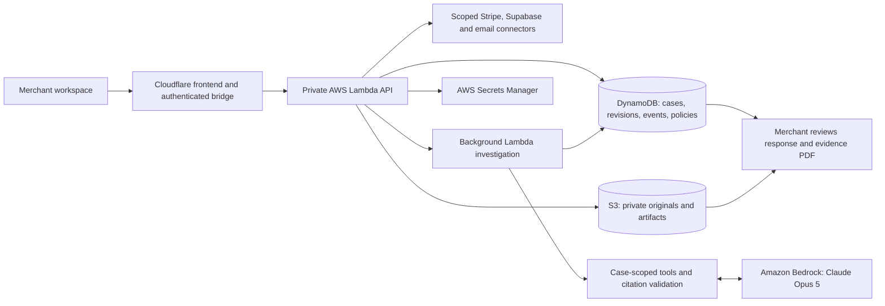

# Causality: judge walkthrough

Causality assembles transaction evidence into a cited chargeback response and a professional PDF for merchant review.

## Where to start

- [Live app](https://causality-hackathon-dev.slidah60.workers.dev), team-guided access. This is a shared development workspace, not a public self-service trial.
- [Final source snapshot](https://github.com/ericshteremberg/champs-scu-aws-hackathon/tree/0df300af9207d503c872d3c5c8b8a95dbad0b14d). Repository access must be resolved before submission. [Main](https://github.com/ericshteremberg/champs-scu-aws-hackathon/tree/main) integrates this deployed feature with the compatible workspace updates; the live deployment and accepted report remain unchanged.
- [Current implementation handoff](../HANDOFF.md), [policy workflow](../POLICY_COLLECTION.md), and [PDF evidence system](../EVIDENCE_PACKET.md).

## Demonstration sequence

| Time budget | Presenter | Show and explain |
| --- | --- | --- |
| 0:00 to 0:50 | Eric | Explain the ticketing business and the work required to respond to a dispute. Define the buyer: the operator who currently gathers evidence manually. |
| 0:50 to 1:25 | Alex | Open a case. Show connected sources and the Get evidence workflow. Explain that records are linked to the selected transaction before investigation. |
| 1:25 to 2:40 | Ayan | Open the saved final report, follow a citation to its record, then show the PDF's argument and supporting exhibit. Distinguish an original document from a rendering of retrieved data. Show merchant review. |
| 2:40 to 3:30 | Aiden | Explain the AWS components and how the control loop restricts the model. Close with the proposed business model and next vertical. |

This 3:30 plan is a rehearsal target based on the team's existing script, not a verified organizer time limit. Use the finished report during the pitch. The successful live Opus run took 120.37 seconds, so waiting through a fresh run would consume much of the presentation. Do not imply that a saved report is being generated live.

## AWS architecture

CloudFormation reproduces the AWS resources. CloudWatch provides operational logs. The app uses Bedrock Converse with an application-controlled tool loop; do not describe it as a deployed Bedrock Agents or AgentCore service. The model has evidence retrieval and report tools, not payment or submission tools. The frontend remains Cloudflare-hosted; the backend, data persistence, private file storage, and inference run on AWS.

## What makes the demonstration credible

- Real business workflow and connected records, with an inspectable response rather than a generic chatbot answer.
- Source matching is constrained to the selected case, including approved Supabase mappings and scoped mailbox retrieval.
- The PDF can include available original documents and labeled captures. It does not manufacture unavailable source artifacts.
- A policy can support an argument without proving historical disclosure or acceptance. The system keeps those distinctions explicit.
- New evidence or edits can invalidate prior review, and stale background results cannot overwrite newer work.
- The application does not decide the bank's outcome. No win-rate improvement or recovered-money result has been established.

## Business case to explain

The initial buyer is a small ticketing business or event organizer handling repeated disputes. The benefit to test is less time collecting and assembling evidence, plus more consistent merchant review. The proposed pricing model is a monthly subscription with an included case allowance and usage-based overage. Pricing and willingness to pay have not been validated.

Use a clearly hypothetical labor example if asked: saving 20 minutes per case at an assumed $30/hour is $10 of labor per case; at 100 cases/month, that is $1,000/month before subscription cost. Neither the time saved nor labor rate is a measured customer result. Avoid claiming higher dispute win rates.

Model cost per investigation is the sum of all tool rounds: `(input tokens × input rate + output tokens × output rate) / 1,000,000`, plus retries and any applicable caching costs. Add Lambda compute, DynamoDB operations, S3 storage/requests, Secrets Manager, CloudWatch, frontend costs, provider plans, and support. Confirm the selected model/profile rates on [AWS pricing](https://aws.amazon.com/bedrock/pricing/) before quoting a dollar cost. The workshop's credit balance is not a production cost estimate. Current prototype concurrency limits are intentionally small; production scale needs queueing, backpressure, and tenant quotas.

## Questions everyone should be able to answer

1. What does AWS do? Explain Lambda, Bedrock, DynamoDB, S3, Secrets Manager and CloudFormation, with a concrete role for each.
2. Why is this more than a prompt? Explain source matching, bounded tools, citations, policy versioning, original artifacts and human review.
3. What happens when evidence is missing or contradictory? The report must retain relevant uncertainty and contrary facts; there is no fabricated proof.
4. Can the model submit or move money? No. The demo button is inert and server-side submission routes are disabled.
5. What remains before a commercial launch? Individual tenant access, security and retention review, dependable onboarding, operational monitoring, broader evaluations and measured economics.

## Recording and presentation materials

Use current app screens: case overview, linked source record, report, and PDF exhibit. Public screenshots or videos should use reviewed redacted copies of customer material, with any masking disclosed. Do not publish development credentials or private originals. A generated record capture must remain labeled as a rendering, not an original provider screenshot.

The existing `docs/demo/casework-hackathon-demo.mp4` is a historical synthetic Casework prototype and is not the final Causality/Opus demonstration. Record the current interface for the final video. Keep a local backup video and PDF for judging in case the workshop session expires. The shared development login should be handled privately during a guided demo.
